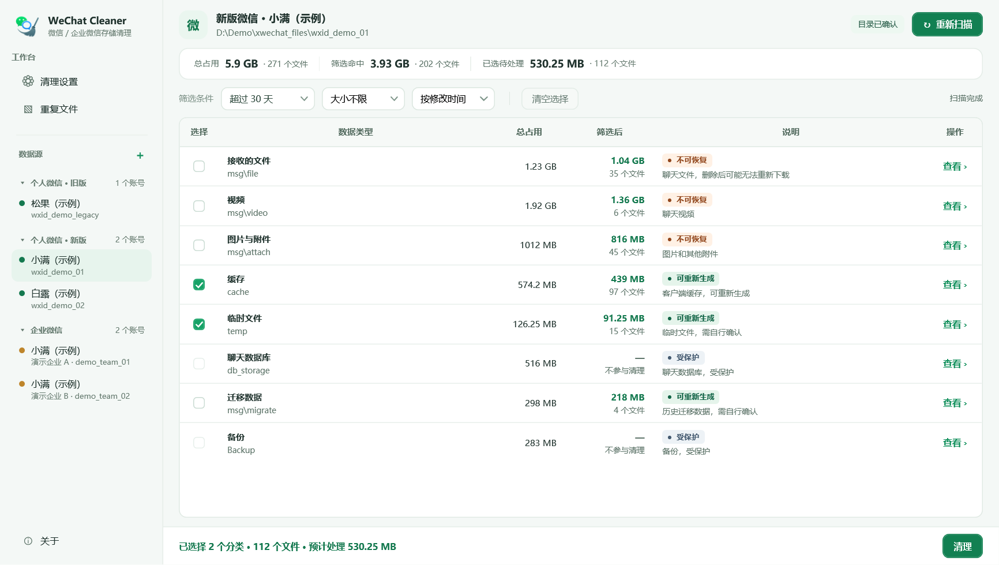
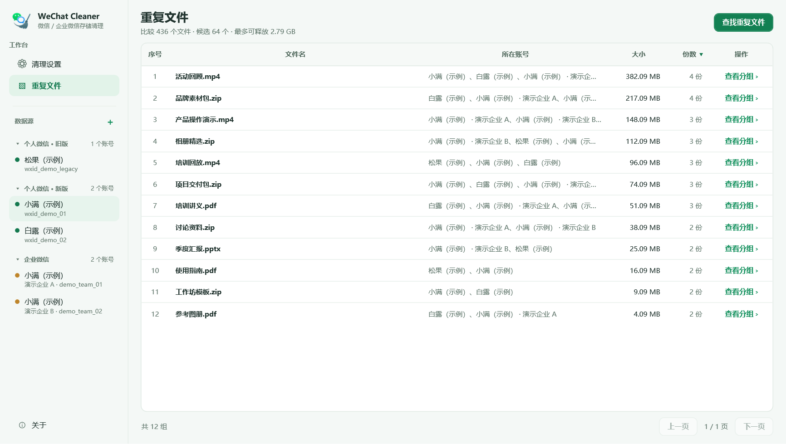

# WeChat Cleaner


适用于 Windows 的微信和企业微信文件管理工具。界面使用 C#、WPF 和 .NET Framework。发布为一个 AnyCPU EXE，随系统使用 32 位或 64 位进程。

## 主要功能

- 同时管理旧版微信 3.x、新版微信 4.x 和企业微信，支持多个账号和企业。优先自动查找数据目录，也可以手动添加绿色版或自定义目录。
- 按文件类型统计占用，再按时间与大小筛选。清理前可逐条确认、排除或导出；聊天数据库等受保护数据不会纳入清理。
- 跨账号查找内容相同的重复文件，逐组核对后再处理。扫描和统计在本机完成。

## 界面截图

以下截图从 C# 版实际界面生成。账号、企业、文件名、大小、时间和路径均为演示数据。

### 清理主界面

查看各数据源的账号、分类占用、筛选命中和预计清理空间。



### 文件明细

按类型筛选、排序和分页；逐条选择、查看、另存或导出文件清单。


### 重复文件

按内容查找重复项，查看分组、所在账号和可释放空间。



### 清理设置

设置默认筛选条件和清理方式，默认移入 Windows 回收站。


### 关于

查看版本、作者和项目仓库。


## 系统要求

| 系统 | 架构 | 运行环境 |
| --- | --- | --- |
| Windows 7 SP1 | x86、x64 | .NET Framework 4.6.2 或该系统支持的更新版本 |
| Windows 10 | x86、x64 | .NET Framework 4.6.2 或更新版本 |
| Windows 11 | x64 | 系统自带满足要求的 .NET Framework，没有 32 位 Windows 11 版本 |

需要补装运行库时，请从微软下载 [.NET Framework 4.6.2 Runtime](https://dotnet.microsoft.com/zh-cn/download/dotnet-framework/net462)。已经安装满足版本要求的运行库时可直接打开 EXE。

## 使用

1. 打开程序。它在后台合并已保存的数据源和本机发现的账号，首次打开账号时自动扫描。新旧版微信可以并存，企业微信账号按各自的数据目录显示。能确认的昵称和企业名会自动显示。
2. 启动查找支持 Windows「文档」重定向、腾讯路径配置及只读注册表线索、安装或运行路径、微信快捷方式和常见绿色版目录。完全自定义且没有这些线索的绿色版目录可在「数据源」右侧点击 `+`，选择类型后手填或选取路径。应用会记住手动添加的目录。
3. 在「清理设置」检查默认时间、大小和清理方式。新配置默认「移至回收站」，已有设置继续生效。扫描只读取文件与统计信息；从清单执行清理时需要确认。
4. 类型表显示总占用和筛选命中，明细支持排序、类型筛选、分页、勾选和导出 CSV/XLSX。「确定」会应用勾选；「取消」或右上角关闭会放弃本次勾选修改。
5. 「重复文件」先按大小分组，再核对内容。打开分组可检查各副本。受保护文件始终排除在清理之外。无法安全放入回收站的文件会保留，并提示失败原因。

设置和手动数据源保存在 `%LOCALAPPDATA%\WeChatCleaner`。查找、扫描及统计在本机完成。

## 构建与验证

在 Windows 上安装 .NET Framework 4.6.2 Developer Pack，进入本目录：

```powershell
msbuild .\WeChatCleaner.csproj /t:Rebuild /p:Configuration=Release
msbuild .\tests\WpfRegression.csproj /t:Rebuild /p:Configuration=Release
```

主程序在 `bin\Release\WeChatCleaner.exe`，回归程序在 `tests\bin\WpfRegression.exe`。也可以使用系统自带的 .NET Framework MSBuild；使用单独下载的官方参考程序集时，传入 `/p:TargetFrameworkRootPath=<包含 .NETFramework\v4.6.2 的目录>`。要构建专供验证的 x86 版本，加上 `/p:PlatformTarget=x86`，并使用独立的输出目录。

在本地磁盘上选择专用测试目录，设置环境变量 `WCC_TEST_DIR` 后，在 Windows 桌面会话运行 `WeChatCleaner.exe --self-test` 和 `WpfRegression.exe`，等待进程结束并检查退出码。

两组测试使用生成的文件。WPF 回归自动注入测试目录和独立配置，避免把真实账号加入清理验证。结果分别记录在 `result.txt` 和 `wpf-results.txt`；通过时退出码均为 `0`。手动试运行也可设置 `WCC_PROFILE_DIR`，使用独立配置。

## 项目信息

- 作者：[HaleShaw](https://github.com/HaleShaw)
- 许可证：[GNU GPL v3](LICENSE)
- AutoHotkey 旧版：[autohotkey 分支](https://github.com/HaleShaw/WeChatCleaner/tree/autohotkey)
