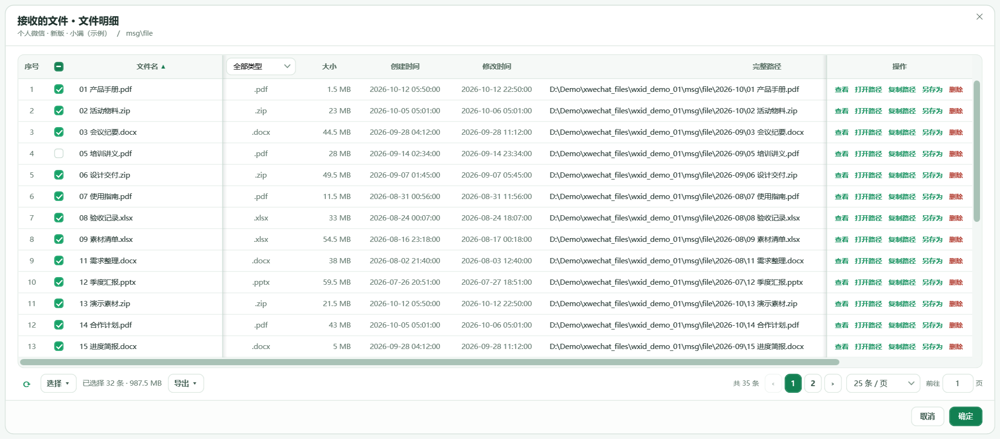
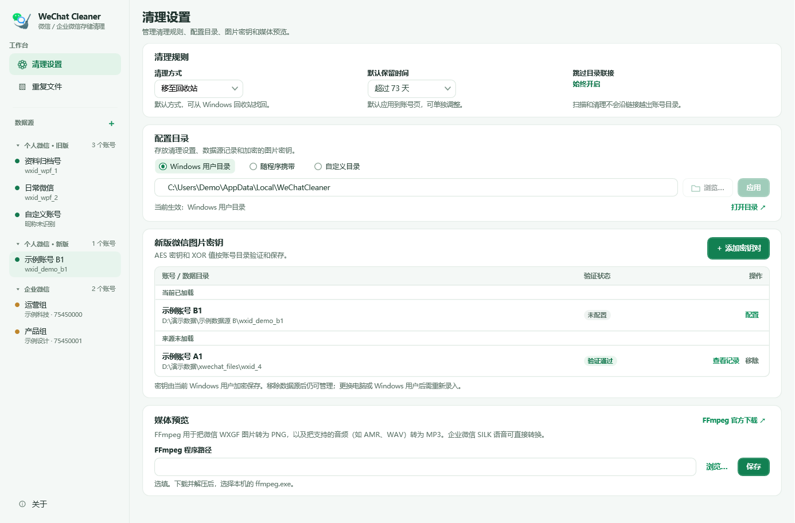
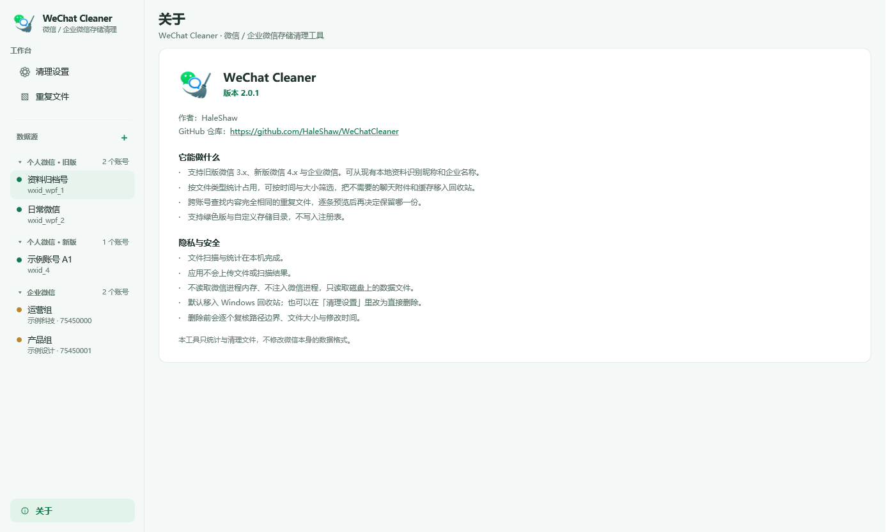
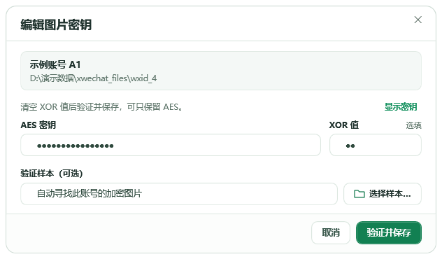
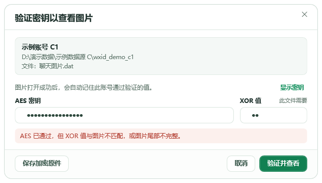

# WeChat Cleaner


适用于 Windows 的微信和企业微信文件管理工具。界面使用 C#、WPF 和 .NET Framework。发布为一个 AnyCPU EXE，随系统使用 32 位或 64 位进程。

**当前版本：2.0.1**。新版微信图片支持在设置、查看和另存时统一录入 AES 密钥与 XOR 值。使用过的账号目录和密钥记录可在设置中管理。

## 主要功能

- 同时管理旧版微信 3.x、新版微信 4.x 和企业微信，支持多个账号和企业。优先自动查找数据目录，也可以手动添加绿色版或自定义目录。
- 按文件类型统计占用，再按时间与大小筛选。清理前可逐条确认、排除或导出；聊天数据库等受保护数据不会纳入清理。
- 跨账号查找内容相同的重复文件，逐组核对后再处理。扫描和统计在本机完成。
- 配置可留在 Windows 用户目录、自定义目录，或保存在 EXE 旁随程序携带。新版微信图片密钥按账号目录验证和加密保存，移除数据源后仍可管理。
- 统计企业微信账号目录中的文件，包括聊天缓存。明细可试听 SILK 语音、另存 MP3，以及查看和另存可解码的微信图片。

## 界面截图

以下截图从 C# 版实际界面生成。账号、企业、文件名、大小、时间和路径均为演示数据。

### 清理主界面

查看各数据源的账号、分类占用、筛选命中和预计清理空间。


### 文件明细

按类型筛选、排序和分页；逐条选择、查看、另存或导出文件清单。



### 重复文件

按内容查找重复项，查看分组、所在账号和可释放空间。


### 清理设置

选择清理方式和默认保留时间，切换配置目录，管理当前账号及历史账号的图片密钥，并从「媒体预览」打开 FFmpeg 官方下载页。



### 关于

查看版本、作者和项目仓库。



### 编辑图片密钥

同时编辑 AES 密钥和 XOR 值。两个字段默认遮挡，可同时显示，并可指定同一账号的附件作为验证样本。



### 保存加密原件

从文件明细查看图片时，密钥验证失败后可以继续编辑，也可以直接保存加密原件。



## 系统要求

| 系统 | 架构 | 运行环境 |
| --- | --- | --- |
| Windows 7 SP1 | x86、x64 | .NET Framework 4.6.2 或该系统支持的更新版本 |
| Windows 10 | x86、x64 | .NET Framework 4.6.2 或更新版本 |
| Windows 11 | x64 | 系统自带满足要求的 .NET Framework，没有 32 位 Windows 11 版本 |

需要补装运行库时，请从微软下载 [.NET Framework 4.6.2 Runtime](https://dotnet.microsoft.com/zh-cn/download/dotnet-framework/net462)。已经安装满足版本要求的运行库时可直接打开 EXE。Windows 7 SP1 上若缺少 Universal CRT，需安装微软的 [Universal CRT 更新（KB2999226）](https://support.microsoft.com/help/2999226)，才能运行内置语音转换器。

## 使用

1. 打开程序。它在后台合并已保存的数据源和本机发现的账号，首次打开账号时自动扫描。新旧版微信可以并存，企业微信账号按各自的数据目录显示。能确认的昵称和企业名会自动显示。
2. 启动查找支持 Windows「文档」重定向、腾讯路径配置及只读注册表线索、安装或运行路径、微信快捷方式和常见绿色版目录。完全自定义且没有这些线索的绿色版目录可在「数据源」右侧点击 `+`，选择类型后手填或选取路径。应用会记住手动添加的目录。右击账号可移除所属数据源；移除会在当前配置中记住此选择，微信原文件与已保存的图片密钥均保留。通过 `+` 可重新添加。
3. 在「清理设置」下拉选择清理方式，默认「移至回收站」，也可选「直接删除」。默认保留时间可下拉选预设，或输入 1 至 36,500 的整数天数，按回车或离开输入框保存。已有设置继续生效；执行清理前会显示确认。
4. 类型表显示总占用和筛选命中，明细支持排序、类型筛选、分页、勾选和导出 CSV/XLSX。「确定」会应用勾选；「取消」或右上角关闭会放弃本次勾选修改。
5. 「重复文件」先按大小分组，再核对内容。打开分组可检查各副本。受保护文件始终排除在清理之外。无法安全放入回收站的文件会保留，并提示失败原因。

查找、扫描及统计在本机完成。

## 配置目录与便携使用

在「清理设置 → 配置目录」选择存放方式：

| 存放方式 | 位置 |
| --- | --- |
| Windows 用户目录 | 默认使用 `%LOCALAPPDATA%\WeChatCleaner`，已存在的设置可继续使用。 |
| 随程序携带 | 使用 EXE 所在目录的 `.\config`。移动或复制时请带上整个 `config` 文件夹。 |
| 自定义目录 | 手动输入完整路径或浏览选择。Windows 会为当前位置的 EXE 记住所选目录。 |

点「应用」后，空目录可复制现有设置、数据源记录与加密密钥库。目标已有配置时，可直接启用该配置，或先备份再复制。切换成功后立即重新加载；原目录和微信文件保留。选择「使用目标配置」会加载目标自身的来源和密钥；如需一同迁移，请选复制。已设定的自定义目录不可用时，程序会提示重试或重新选择，避免自动初始化一份空配置。

环境变量 `WCC_PROFILE_DIR` 可在启动时显式覆盖路径；设置页会显示覆盖状态。数据源记录使用实际路径，移动到另一台电脑或变更盘符后可能需要重新添加。预览与转换临时文件仍使用当前 Windows 用户的临时目录。

## 企业微信统计与清理

按企业微信账号目录统计可读取的文件，每个文件只计一次。`Cache\File`、`Cache\Image`、`Cache\Video`、`Cache\Voice` 分别显示为聊天文件、图片、视频和语音；满足筛选条件时可在核对后清理。它们标为「不可恢复」，因为缓存清掉后不一定能从聊天中重新下载。

聊天数据、索引、`CacheMapping`、微盘、备份、其他未识别的缓存和账号文件只计入占用，不纳入清理。扫描会跳过文件系统链接和不可访问的内容。

## 查看与另存附件

在「文件明细」或「重复文件分组」使用「查看」或「另存为」。程序读取文件内容识别格式，源文件不会因预览或转换而改写。

| 数据位置 | 查看和另存行为 |
| --- | --- |
| 企业微信 `Cache\Voice` | 识别 SILK 语音，包括没有扩展名的语音，转换为 MP3。「查看」用系统默认播放器打开；「另存为」保存 `.mp3`。 |
| 旧版微信 `FileStorage\MsgAttach`、`FileStorage\Image` | 自动识别普通媒体和常见 XOR 封装。照片以识别出的图片格式查看或保存，例如 JPEG、PNG；可识别的 SILK 音频转为 MP3。 |
| 新版微信 `msg\attach` | 识别普通媒体、旧式 XOR 和 AES V1/V2 封装。V2 使用对应账号的图片 AES 密钥，部分文件还需要 XOR 值。 |

新版微信 V2 的 JPEG 和 PNG 按文件结构定位结尾，去掉容器填充。由连续 JPEG 和附带 MP4 组成的动态照片会保留全部画面和视频。能否播放动态部分取决于打开文件的查看器。

### 新版微信图片密钥

- **在设置中配置。** 打开「清理设置 → 新版微信图片密钥」，选择账号，直接粘贴已取得的值。AES 接受 16 个可打印 ASCII 字符或 32 位十六进制字符。XOR 接受两位十六进制字符，如 `A6` 或 `0xA6`；仅需 AES 时可留空。
- **验证和更换。** 程序会从该账号的 `msg\attach` 查找可验证的 V2 图片，也可手动选样本。列表区分「验证通过」「AES 已验证」「待验证」「暂无可验样本」和「验证失败」。如果样本只验证了 AES，可另选能验证 XOR 的样本，或清空 XOR 后仅保存 AES。验证失败会保留原密钥；未配置或待验证的账号在找不到样本时，可以明确选择「保存为待验证」，之后再验证。
- **在查看或另存时填写。** 优先尝试当前目录的已保存值。没有密钥或与该图片不匹配时，可在弹窗填写并重试。图片打开或解密文件写出成功后，自动保存通过验证的值。只验证了 AES 时会保留旧 XOR；若 AES 已变，原 XOR 会标为待验证。取消操作、验证失败或保存加密原件均不会改写密钥。
- **保存加密原件。** 输入弹窗里可一直使用这个选项。它直接复制源文件字节，默认沿用原文件名和扩展名，不改动微信目录中的文件。

| 数据源变化 | 设置页与密钥行为 |
| --- | --- |
| 移除来源 A，再添加另一个账号 B1 | A1 显示在「来源未加载」，可查看上次验证结果或移除历史密钥；B1 独立配置。 |
| 重新添加原账号目录 | 复用此路径的原记录。 |
| 同一账号搬到新目录 | 账号目录标识唯一匹配时可「关联旧记录」。先用新目录的样本验证，再保存到新目录。旧记录仍保留。 |
| 同昵称或存在多个同账号备份 | 为当前目录单独录入，程序不会根据昵称或多个候选目录猜测。 |

密钥保存在配置目录的 `image-keys.txt`，AES 和 XOR 由 Windows DPAPI 按当前用户加密。旧版加密记录可继续使用；没有验证状态的旧记录会标为待验证，只有路径摘要的记录在加载原账号目录后会补全账号信息。更换电脑或 Windows 用户后，需要重新录入。这里填写的是图片密钥；微信登录密码不能用于解密。未取得密钥时可以在微信内查看，或在本程序另存加密原件。

**FFmpeg（可选）。** 在「清理设置 → 媒体预览」点击「FFmpeg 官方下载」，由默认浏览器打开 [FFmpeg 官网的 Windows 下载页](https://ffmpeg.org/download.html#build-windows)。选取适合本机 Windows 版本和架构的构建，解压后在「FFmpeg 程序路径」手填或浏览选择 `ffmpeg.exe`。选择后立即保存；手填可以按回车或点「保存」。支持 HEVC 的 FFmpeg 可把部分 WXGF 图片的首帧转为 PNG；支持 `libmp3lame` 时，也可将可识别的 AMR、WAV、FLAC、Ogg 或 M4A 转为 MP3。没有可用的转换器时仍可另存已解包的 WXGF。内置的 SILK 转 MP3 不需要 FFmpeg。路径留空并保存可移除本机设置；如在启动时已设 `WCC_FFMPEG`，空路径时作为兼容选项使用该环境变量。

## 构建与验证

在 Windows 上安装 .NET Framework 4.6.2 Developer Pack，进入本目录：

```powershell
msbuild .\WeChatCleaner.csproj /t:Rebuild /p:Configuration=Release
msbuild .\tests\WpfRegression.csproj /t:Rebuild /p:Configuration=Release
```

主程序在 `bin\Release\WeChatCleaner.exe`，回归程序在 `tests\bin\WpfRegression.exe`。也可以使用系统自带的 .NET Framework MSBuild；使用单独下载的官方参考程序集时，传入 `/p:TargetFrameworkRootPath=<包含 .NETFramework\v4.6.2 的目录>`。要构建专供验证的 x86 版本，加上 `/p:PlatformTarget=x86`，并使用独立的输出目录。

在本地磁盘上选择专用测试目录，设置环境变量 `WCC_TEST_DIR` 后，在 Windows 桌面会话运行 `WeChatCleaner.exe --self-test` 和 `WpfRegression.exe`，等待进程结束并检查退出码。

两组测试使用生成的文件。WPF 回归自动注入测试目录和独立配置，避免把真实账号加入清理验证。结果分别记录在 `result.txt` 和 `wpf-results.txt`；通过时退出码均为 `0`。设置回归包括配置切换和备份、便携定位、路径断开恢复、旧密钥兼容与账号目录切换；附件回归使用合成的 V2 样本验证 AES 和 XOR、带填充的 JPEG 和 PNG、带视频的多图 JPEG、成功后自动记住、取消后保留记录，以及按原始字节另存。手动试运行也可设置 `WCC_PROFILE_DIR`，使用独立配置。

内置语音转换器的源码、构建方法及第三方许可证见 [tools/voice](tools/voice/README.md)。

## 项目信息

- 作者：[HaleShaw](https://github.com/HaleShaw)
- 许可证：[GNU GPL v3](LICENSE)
- AutoHotkey 旧版：[autohotkey 分支](https://github.com/HaleShaw/WeChatCleaner/tree/autohotkey)
